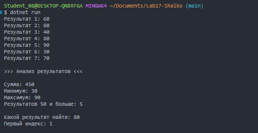

# Практическая работа №17

Автор: Шалько Андрей  
Группа: ИСП-252

## Тема

Алгоритмы обработки массивов.

## Что реализовано

- сумма элементов;
- подсчёт элементов по условию;
- минимум и максимум;
- линейный поиск;
- поиск первого индекса.

## Короткие ответы

1. Почему максимум нельзя всегда начинать с `0`?

Ответ: если в массиве все числа отрицательные, то максимум будет меньше 0 и будет неверный результат.

2. Что означает `-1` после поиска индекса?

Ответ: означает, что элемент ненайден, потому что массивы начинаются с 0.

3. Чем сумма отличается от подсчёта элементов?

Ответ: сумма это сложение значения элементов, а подсчет, когда считают сколько элементов подходят по условию.

## Результат

